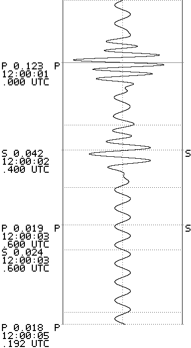

# USTCShake LPPNM Firmware

科普地震仪 V2 / ESP32-C3 的固件重写项目：250 Hz 实时采样、横向 OLED 波形、热敏打印、三键菜单，以及 **LPPNM 融合 INT8 增量震相拾取**。

- 3072 点历史，100 Hz 模型输入，每 128 点更新（1.28 秒）。
- 250 → 100 Hz 有状态抗混叠重采样；单分量波形复制为三分量。
- Conv/BN 融合，39 个 W8A8 卷积；逐层缓存，只计算新增数据。
- P/S 默认阈值均为 **0.01**，菜单可调。
- 屏幕按真实到时回标 P/S；纸上同一到时行绘制虚线、P/S 字母，左侧显示置信度和毫秒到时，末尾另列到时清单。
- 纸质波形缓冲约 **6 秒**，等待模型确认；采样、屏幕和 USB 输出继续运行。

这是根据设备行为和接口重新实现的固件，**不是原厂源码或原厂固件发布**。默认滤波系数经过原固件运行值对照；图标、字体、菜单布局与原厂不完全相同。只在下面列出的 PCB V2 硬件上做过短时测试。

## 硬件

| 部件 | 已验证配置 |
| --- | --- |
| 主控 | ESP32-C3，160 MHz，4 MB Flash，无 PSRAM |
| ADC | ADS1115，I²C 地址 0x48，AIN0–AIN1 差分，连续 250 SPS，±4.096 V，125 µV/LSB |
| I²C | SDA GPIO7，SCL GPIO6，100 kHz |
| 屏幕 | SH1122，256×64，SPI 8 MHz |
| OLED SPI | SCK GPIO3，MOSI GPIO2，CS GPIO0，DC GPIO1，无单独 reset |
| 按键 | 左 GPIO10、中 GPIO8、右 GPIO4；低电平按下，外部上拉 |
| 热敏打印 | UART1 TX GPIO5，初始化 9600 baud 后切换 115200，384 点宽 |
| 纸张 | 57×50 mm 热敏纸 |

引脚来自原固件反汇编与运行时 GPIO matrix 交叉核对。别的硬件版本需自行核对 `include/board.hpp`。
使用说明要求打印时推荐 9 V / 2 A；连接 Mac 或使用 USB-C 接口本身不能证明已获得 9 V。

## 使用

1. 开机后轻敲观察波形。模型约需 31 秒预热，底部显示 `AI warmup …/3072`。
2. 预热结束显示最近一批输出的 P/S 概率。候选确认有数秒延迟，标记回填到实际到时位置。
3. 左右键切换自动 / 固定量程。自动量程参考最近 5 秒极值；打印时锁定量程。
4. 短按中键开始打印。纸质波形约延迟 6 秒；输入采集仍保持 250 Hz。
5. 长按中键 1.2 秒进入菜单。左右选择，中键编辑；长按返回，选择应用、放弃或继续设置。
6. 菜单支持时长、量程、高通、低通、显示单位、打印图标和震相阈值。设置只在本次开机有效；打印中不应用更改。
7. 手机连接 `USTCShake-Time-xxxx` Wi-Fi 后访问 `http://192.168.4.1` 授时。该网址在设备的 Wi-Fi 网络内可用，不是通过 USB 自动提供的网站。

打印到时使用 UTC；未授时时明确使用 `BOOT` 开机相对时间。滤波默认 0.5–10 Hz。速度显示沿用已读取的加载灵敏度 20.9454536 mV/(mm/s)，未对检波器频响进行反卷积补偿。

下图是**同一光栅代码生成的合成测试图，不是实纸照片**。左侧依次是类型 / 置信度、时分秒、毫秒与时区。相邻文字可顺次排列，横向到时线始终留在对应采样行。



## 构建

只构建固件不需要 PyTorch。量化模型已以只读 C++ 数组形式提供在 `model/artifacts/model.hpp`。

```sh
python3 -m venv .venv
. .venv/bin/activate
python -m pip install platformio==6.2.0 esptool==5.6.0 pyserial==3.5
pio run
```

依赖已固定：Espressif32 6.12.0、Arduino ESP32 2.0.17、U8g2 2.36.17。输出为 `.pio/build/esp32c3/firmware.bin`。
分区表采用原设备布局：app0 在 `0x10000`，大小 `0x300000`。这是 **app-only** 镜像，不是从 `0x0` 烧入的整片镜像。

## 备份与写入

先确认自己的设备型号、MAC、分区及 4 MB Flash。完整读取两次并比对，把备份保存在仓库外：

```sh
python -m esptool --chip esp32c3 --port YOUR_PORT --after no-reset read-flash 0 0x400000 /private/path/original.bin
python -m esptool --chip esp32c3 --port YOUR_PORT read-flash 0 0x400000 /private/path/original.verify.bin
cmp /private/path/original.bin /private/path/original.verify.bin
```

确认备份后，使用显式设备标识上传。脚本先构建，检查备份大小和目标 MAC，再只写 app0：

```sh
python tools/flash_app.py --port YOUR_PORT --expected-mac YOUR_DEVICE_MAC --backup /private/path/original.bin
```

写入工具不擦除 NVS，也不替换分区表、引导程序和 SPIFFS。实际运行的 Wi-Fi/系统组件可能更新其自身 NVS。
完整备份包含设备配置，**不要提交到公开仓库**。需要恢复时，将自己的完整备份写回 `0x0`。

## 验证

```sh
sh tools/test_host.sh
python tools/audit_device.py --port YOUR_PORT
```

主机测试包括：原默认滤波系数、FIR 抗混叠与时间补偿、候选去重、按键去抖、C++ 推理重置与零运行时堆分配，以及纸上同到时 P/S、文字排队和打印末端标注。
板端脚本约运行 120 秒，含 60 秒模拟打印负载，**不向打印机发送走纸光栅**。

2026-10-30，带纸上标注版本的短时测试结果，见 [机器可读报告](docs/device_stress_summary.json)：

| 指标 | 结果 |
| --- | --- |
| 增量推理最大耗时 | 174,219 µs，更新间隔 1,280,000 µs |
| 采样调度丢失 / ADC 读取失败 | 0 / 0 |
| 推理队列丢失 / 重置 | 0 / 0 |
| 模拟打印 | 7,500 波形行，10 个到时标记 |
| 打印队列溢出 / 标注文字丢弃 | 0 / 0 |
| 连续 USB 样本 / 序号缺口 | 19,990 / 0 |
| 最小剩余堆 | 73,084 bytes |

USB 审计最初把一次 `readline` 超时得到的半条 JSON 当成完整行。两段原始内容拼接后 24 个样本全部存在；报告记录了这一修正，当前脚本会一直积累到换行才解析。
这些计数证明本次任务调度测试通过，不能替代长期丢样测试、转换器时钟校准或实纸验收。屏幕方向已由设备使用者确认；新增纸上标注的实纸效果仍需实际打印核对。

## 模型重建

详见 [模型说明](docs/MODEL.md)。如需重新融合、校准和导出：

```sh
git clone https://github.com/cangyeone/pnsn third_party/pnsn
git -C third_party/pnsn checkout 1f955f4d8cffbc5c43584f02ef14a0da2b0aeb6b
python -m pip install -r model/requirements-tested.txt
python model/build.py
python model/export_cpp.py
```

可用 `PNSN_REPO` 指定已有上游目录，`LPPNM_CALIBRATION_WAVEFORM` 指定至少 25,600 点的 100 Hz 单分量校准波形。
默认使用上游提供的 `*53085*BHZ*.sac`。重新校准会改变量化尺度，应重新执行模型验证和板端测试。

## 限制

- 阈值 0.01 用于多显示弱候选，输出不代表已确认地震。该检波器与三路复制输入上的实际拾取准确率尚未用标注数据评估。
- 原网络有双侧卷积，输出需等待未来上下文；不是零延迟因果网络。六秒纸张缓冲用于到时回标。
- 归一化是逐样本、3072 点因果统计；与旧逐窗重新归一化不同。已验证的是相同因果输入下整段与增量计算一致。
- 校准数据只有一条波形，已有报告不是完整精度评测。
- 输入缺口会重置模型并重新预热。未覆盖的打印区间会标注 `INCOMPLETE MODEL COVERAGE`。
- 打印状态以发送队列为依据；当前无缺纸、电压或温度回读。电脑供电下不能仅凭串口写入成功认定纸张输出正常。
- 重写保留主要操作功能；原厂的全部菜单细节、图标、厂商网页监视器状态字段未做逐项等价验证。

## 来源

LPPNM 源自 [cangyeone/pnsn](https://github.com/cangyeone/pnsn)，固定上游提交见上文。原设备及使用说明来自科普地震仪 V2；本项目与原厂升级站点独立。第三方组件和模型许可范围见 [THIRD_PARTY_NOTICES.md](THIRD_PARTY_NOTICES.md)。
